# AEDEXA
### A site drawing becomes a spatial model you can inspect.

**QwertyS · HTML Challenge 2026 — first place · AI Builders Hackathon — participated, no prize**

[Open the hackathon app](https://aedexa.site/) ·
[Watch the submitted demo](https://www.youtube.com/watch?v=wwHJ0La7rXE) ·
[Read the Devpost submission](https://devpost.com/software/aedexa) ·
[Public hackathon source](https://github.com/pip00sya/aedexa-hackathon)

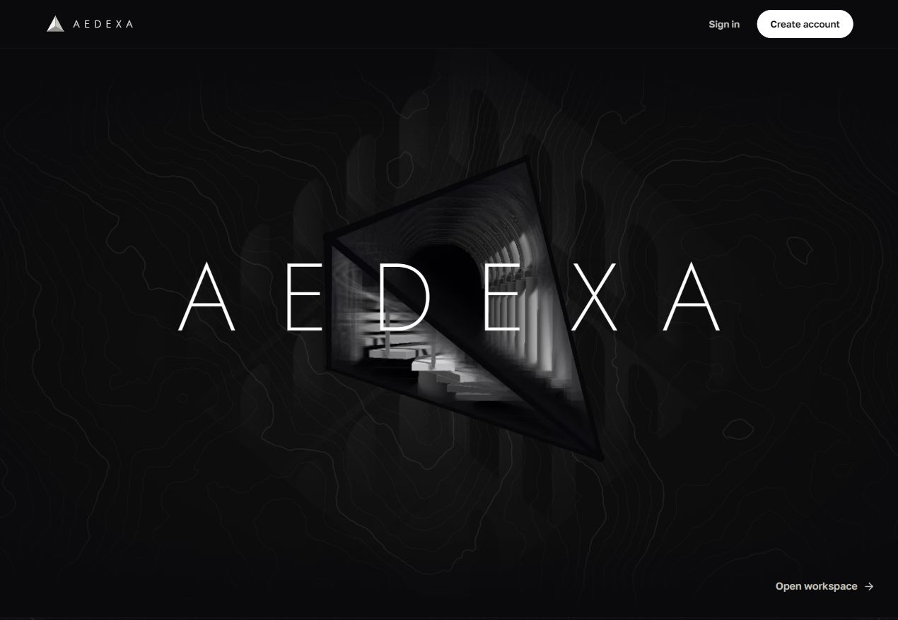

## Watch the submitted demo

[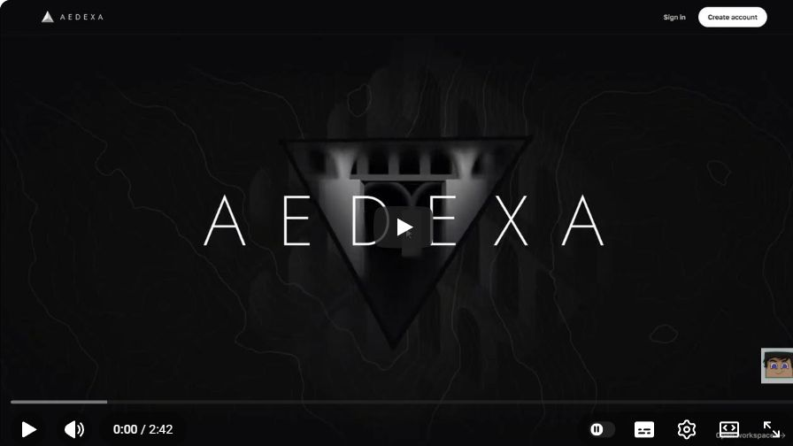](https://www.youtube.com/watch?v=wwHJ0La7rXE)

**[▶ Watch AEDEXA — Devpost AI Builders hackathon pitch and demo](https://www.youtube.com/watch?v=wwHJ0La7rXE)**

The original recording is hosted on Nurkhan Aimukatov's YouTube channel.
Click the preview to watch the hackathon edition. The animation below is the
landing-page identity; it is separate from the submitted product demo.

### The tetrahedron is part of the product's identity

The landing page introduces AEDEXA through a rotating **3D portal tetrahedron**.
Its faces open onto architectural scenes, connecting the geometric mark to the
product's movement between drawings, site geometry and spatial models. The
wordmark, topographic background and alternating drawing-led sections carry
that same visual language into the rest of the page.

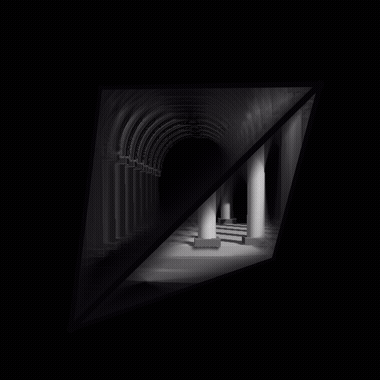

*The original 26-second landing animation, converted to GIF for GitHub.
[Open the retained WebM animation](media/tetra.webm).*

See the full hackathon landing page

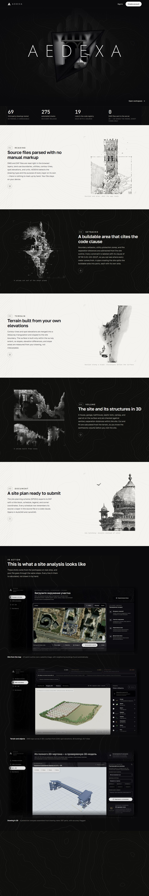

*Captured from the public hackathon host on 12 October 2026. The statistics
are the project's published checks, not a newly performed independent benchmark.*

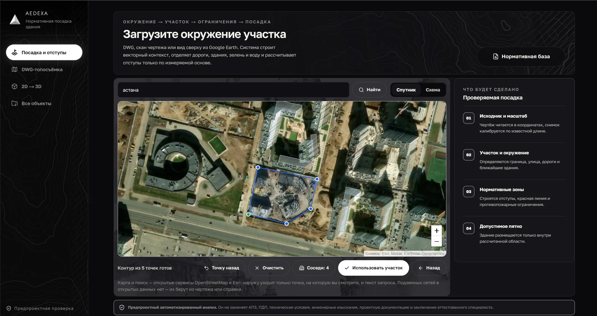

*A capture of the hackathon edition. All product images and public demonstrations in this
repository belong to that edition, including its earlier interface iterations.*

## Start with the land and the evidence

Early architectural decisions bring several kinds of information together: a parcel,
a topographic survey, utility lines, surrounding buildings and a proposed structure.
Those facts are often scattered between CAD files, maps and individual drawings.
AEDEXA puts them into a browser workspace where a user can move from a drawing or map
to a site model, inspect the assumptions and export the result.

The central idea is that a useful model must remain explainable. A measured elevation,
a regulatory value and an AI-inferred detail have different meanings. Missing information
should stay visible rather than becoming an apparently precise number.

## Four ways into the workspace

| Workspace | Input and result |
|---|---|
| Placement and setbacks | A DWG/DXF site drawing, calibrated plan image or map outline leads to a boundary, constraints, buildable area and building placement. |
| DWG topographic survey | Survey geometry, spot elevations and contours become classified objects and a triangulated 3D terrain surface, with DAE/DXF export. |
| 2D to 3D reconstruction | Source views feed an audited parametric recipe, deterministic geometry construction and a separate model review. Model access is required. |
| Project archive | Saved results can be inspected and reopened rather than disappearing after one calculation. |

### Trace the parcel before calculating

A satellite view can establish where the site is, but a traced polygon does not by itself
prove cadastral boundaries or surveying accuracy. The application carries the working
boundary into its calculation and inspection views. CAD layer roles and drawing type
help determine whether an uploaded sheet actually represents a site suitable for placement.

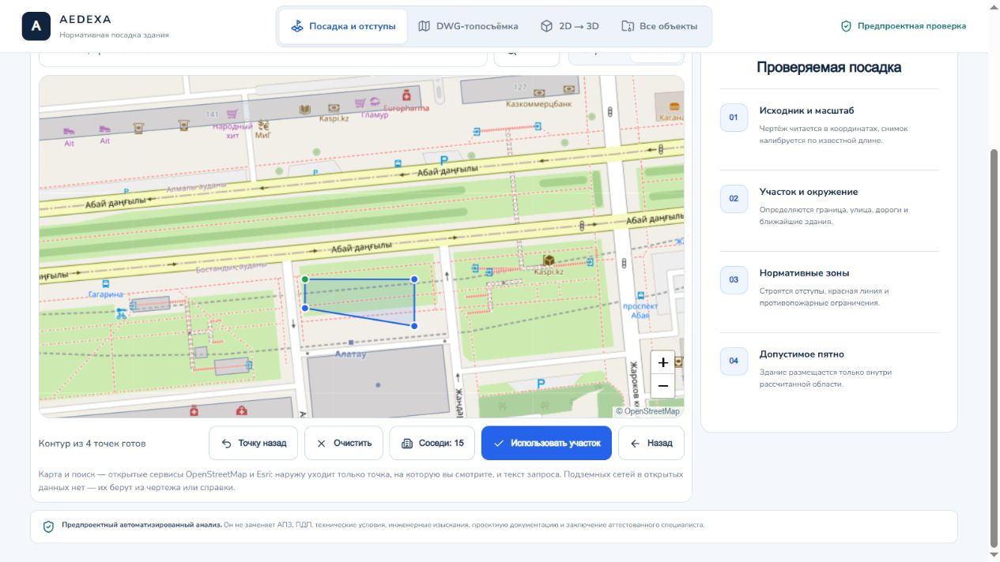

*Earlier hackathon interface: the parcel contour remains a visible, editable input.*

### Read the terrain from above and from the side

An overhead plan is useful for understanding the survey structure; a 3D surface makes
changes in elevation easier to inspect. AEDEXA exposes both views and the geometry used
to build them. DWG decoding runs through LibreDWG WebAssembly, while terrain construction
uses triangulation of the available elevation evidence.

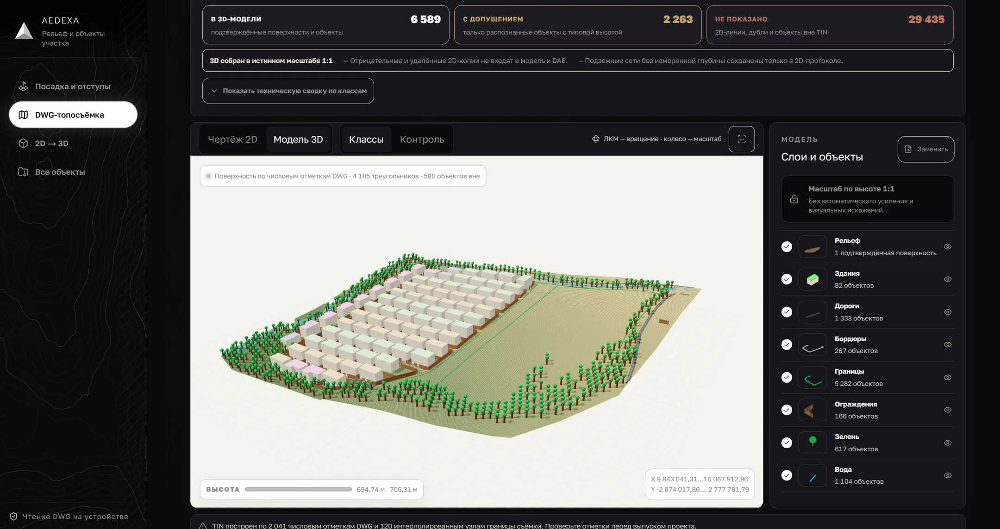

*Topographic processing in the dark hackathon interface.*

Compare the earlier 2D and 3D terrain views

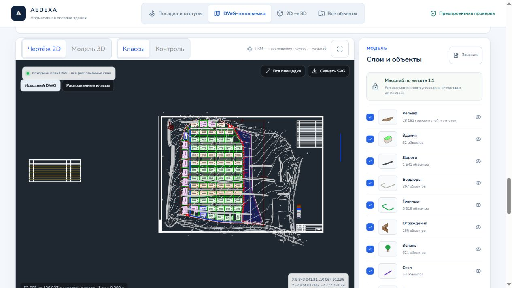

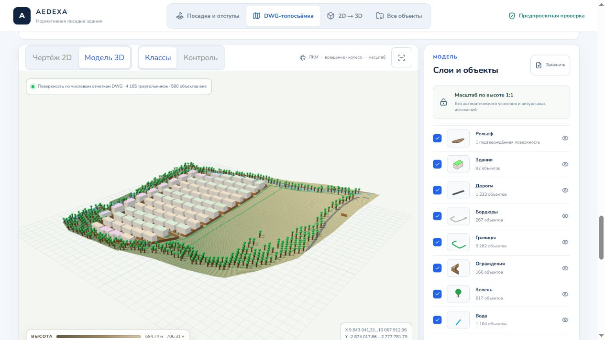

*These captures document the earlier hackathon interface; they are not screenshots of
a separate commercial edition.*

### Make the building and site part of one decision

An isolated model on an infinite grid hides the context that matters in site planning.
The placement view joins the proposed building to the working parcel, terrain and
constraints. Setbacks and utility protection areas contribute to the usable area;
surroundings and building dimensions remain part of the inspection.

*A functional hackathon capture of the placement stage.*

## Reconstruction has to account for the drawing

The browser reconstruction workflow audits the drawing's source views, creates a
structured recipe, checks it against a schema, constructs geometry and runs an independent
visual review. The point is to make unsupported geometry distinguishable from measured
CAD information. AI checks are explicit actions rather than a prerequisite for every
terrain or placement operation.

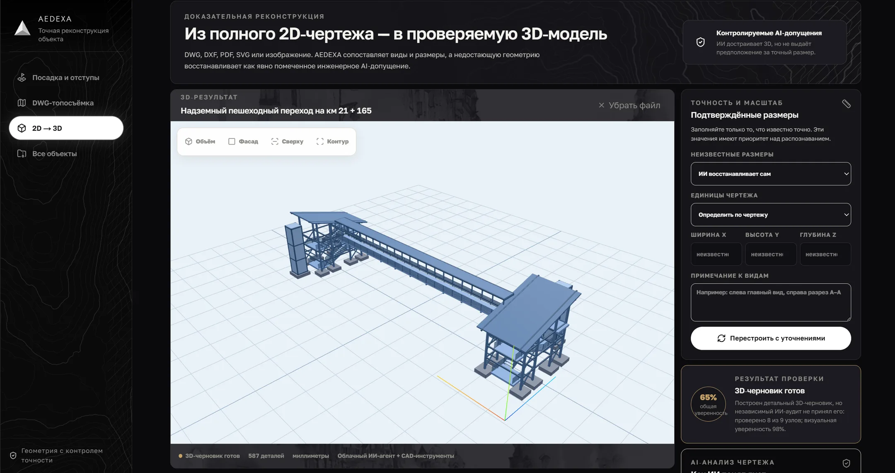

*Hackathon edition: the darker reconstruction workspace.*

Inspect earlier building and overhead examples

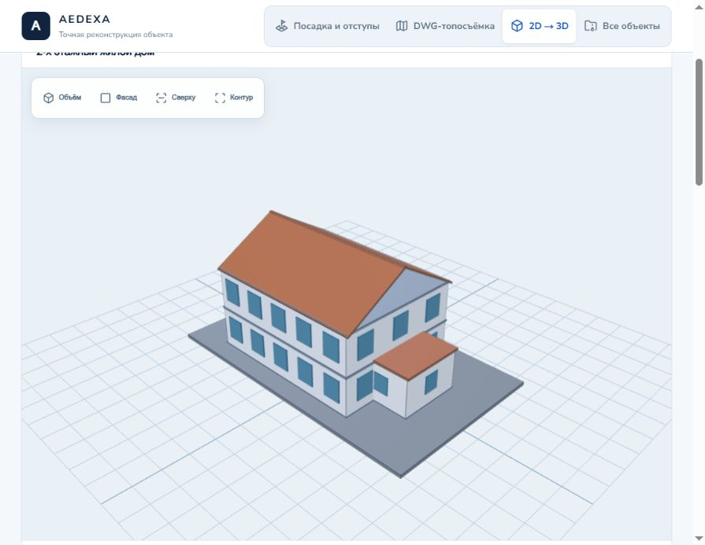

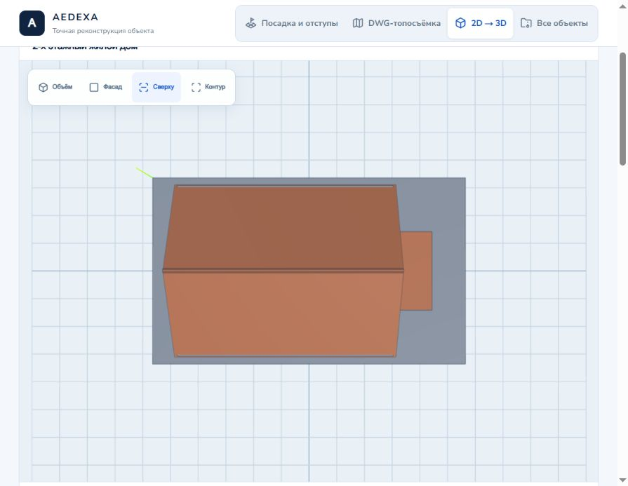

*Multiple viewpoints make footprint and height relationships easier to question.*

## Where the computation lives

The web edition uses **React 19, TypeScript, Vite/vinext, Three.js, Leaflet,
LibreDWG WebAssembly, Delaunator and polygon-clipping**. A Cloudflare Worker serves the
application; Cloudflare D1 supports accounts and project synchronization. Geometry and
terrain calculations run in the browser. Optional AI analysis and reconstruction use
server routes and configured model-provider access.

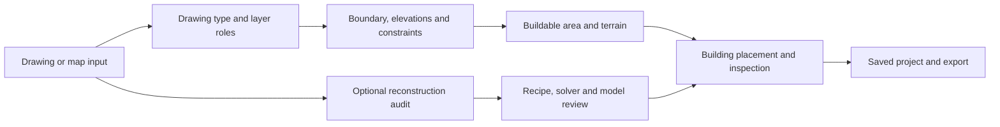

The registry attaches source documents and clauses to planning rules. Results use
statuses including `PASS`, `FAIL`, `MISSING_DATA` and `EXPERT_REVIEW`. This makes incomplete
or unverified inputs visible. It does not turn a hackathon application into an approved
construction-design or regulatory certification system.

## A contest project with a public working release

The [Devpost submission](https://devpost.com/software/aedexa) records **275 automated
checks**, a regression corpus of **69 third-party DWG drawings** (**63 readable models**)
and **19 source-linked building-code rules**. These are the development results reported
for the submitted web edition, rather than a new test execution performed for this showcase.

AEDEXA received **first place at HTML Challenge 2026**. The organizer's
[official results, published 19 September](https://www.instagram.com/html_challenge/p/DddbiW2jNRV/?img_index=2),
name **Qwertys** in first place. It was also submitted to the **AI Builders Hackathon**
on Devpost; that submission did not receive a prize. These are separate events and outcomes.
The [hackathon record](docs/HACKATHON.md) links the event information, submitted project
and video, official result and retained team certificates.

Official HTML Challenge results

*Original organizer artwork from the [19 September results publication](https://www.instagram.com/html_challenge/p/DddbiW2jNRV/?img_index=2).
Credit: HTML Challenge / @html_challenge. Preserved without alteration.*

The implementation includes local setup, geometry tests, demonstration drawings and deployment instructions. The hosted app and submitted video refer to the hackathon edition. This showcase distributes presentation materials; implementation access is managed separately.

### Earlier deterministic reconstruction research

What the earlier Python drawing audit established

The earlier Python investigation audited 66 industrial DWG files. One produced a built
model; other cases stopped at conversion, view discovery, view pairing or supported
geometry checks. This was a diagnostic experiment on that older pipeline, separate from
the browser platform shown above. It is retained as development history rather than
used as a performance claim for the current web workflow.

| Earlier audit outcome | Files |
|---|---:|
| Conversion failure | 2 |
| No usable view, despite captions | 21 |
| No usable view and no captions | 23 |
| Plan/elevation pairing failure | 2 |
| Unsupported or invalid archetype | 17 |
| Model built | 1 |

## Beyond the hackathon edition

The expanded edition is maintained privately and has progressed beyond the competition prototype. As confirmed by the team on 12 October 2026, it is being used in **two company pilots**, with a **usage agreement in place**. These are product-use milestones, not claims of paid revenue or independently measured customer outcomes.

The public gallery and videos document the hackathon edition. Company names, agreement text, customer drawings and the expanded edition's implementation are not published here. The HTML Challenge first-place result and the AI Builders Hackathon participation without a prize refer to different events.

## Award certificate

**1st place at HTML Challenge 2026**, organized by Allinone. The certificate names Akhmer Shakhnazar and team Qwertys. This award belongs to HTML Challenge; the separate AI Builders Hackathon submission did not receive a prize.

[Original documents and certificate gallery](docs/awards/README.md).

View the certificate

**HTML Challenge 2026 — 1st place, Qwertys**

<a href="docs/awards/html-challenge-first-place.pdf">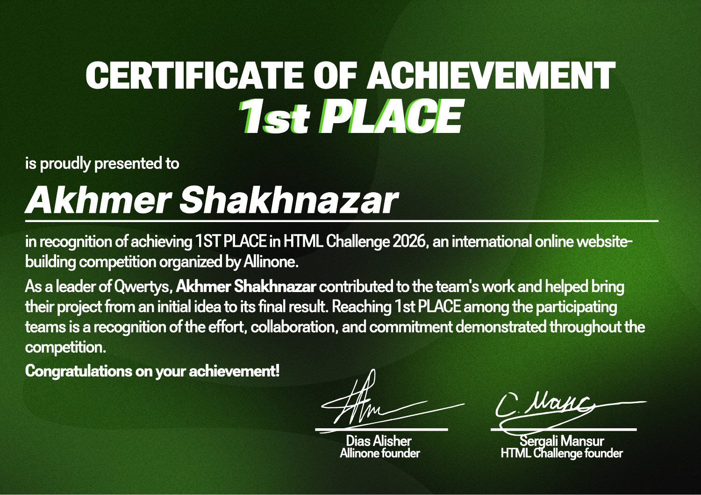</a>

---

### Built by QwertyS

**[Shakhnazar Akhmer / Eye172](https://github.com/Eye172)** and **[Nurkhan Aimukatov / pip00sya](https://github.com/pip00sya)**.

[Companion showcase on Nurkhan's account](https://github.com/pip00sya/aedexa-showcase) · [Shakhnazar's projects](https://github.com/Eye172) · [Nurkhan's projects](https://github.com/pip00sya).

The two showcases document the same joint project. Product facts, authors and evidence are shared; each account maintains its own presentation repository.

[Hackathon record and supporting sources](docs/HACKATHON.md) · [Media provenance](docs/MEDIA.md).
