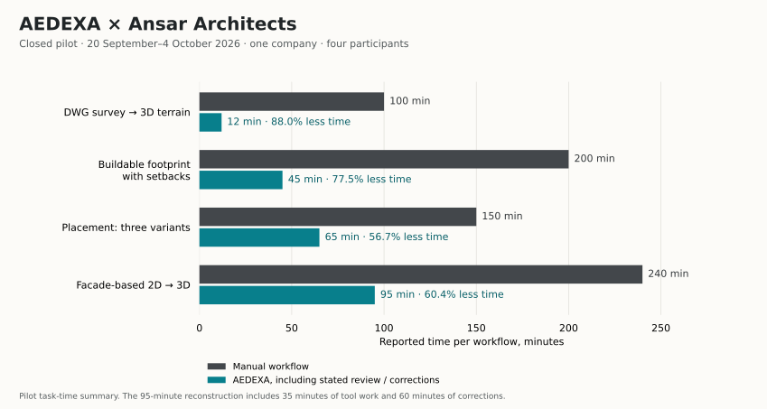

# AEDEXA in an architectural practice

**Ansar Architects · one company · closed pilot: 20 September–4 October 2026**

AEDEXA was evaluated by four professionals on five sites in one architectural
practice. The pilot showed faster early-stage work in four timed workflows and
identified specific gaps in drawing compatibility, geometric accuracy, rule
coverage and usability. Continued trial use started on **5 October**; its results
are a separate stage and are not included in these closed-pilot figures.

## The work behind the numbers

The cohort comprised a **lead project architect, two architects and a site planner**.
They used **three current sites and two archived sites**, with known answers for
the archived material. The file-compatibility sample contained **11 DWG files**.

The pilot combined site boundaries and setbacks, topographic terrain, alternative
building placements, facade-based reconstruction and DAE/DXF export. Baseline
tasks were timed with a stopwatch using the practice's familiar workflow during
the first week. The lead project architect separately judged each planning rule
before comparing those verdicts with AEDEXA.

The pilot set a **50% task-time reduction target**, alongside predefined quality
and usability targets. The published values below are the reported pilot task
times; they are not a distribution of repeated runs or a product-wide guarantee.

## Faster work still includes review

| Workflow | Manual | With AEDEXA | Time reduction |
| --- | ---: | ---: | ---: |
| DWG survey → 3D terrain | 100 min | 12 min | 88.0% |
| Buildable footprint with setbacks | 200 min | 45 min, including rechecking | 77.5% |
| Building placement, three alternatives | 150 min | 65 min | 56.7% |
| Facade-based 2D → 3D | 240 min | 35 min + 60 min of corrections = 95 min | 60.4% |

All four timed workflows exceeded the pilot's 50% reduction target. The
reconstruction result includes the full hour of subsequent corrections; using
only its initial 35 minutes would overstate the improvement. The setback result
also includes rechecking.

DAE/DXF exports still needed **20–30 minutes of manual cleanup** in the working
environment. The no-cleanup target was therefore not met. No manual export
baseline was supplied, so no percentage reduction is calculated for that task.

## Compatibility and geometry

| Check | Pilot target | Observed result | Interpretation |
| --- | --- | --- | --- |
| DWG files fully opened | At least 85% | 8/11, or 72.7%; 2 partial, 1 failed | Below target |
| Parcel area deviation from CAD | At most 1% | Median 0.3%; maximum 1.8% | The median is small; the largest case exceeds the threshold |
| Terrain deviation from Civil 3D | At most 10 cm | Mean 4 cm; maximum 31 cm | The average is below the threshold; the local peak needs review |

The pilot's **8/11** full-opening result belongs to the practice's file sample.
It is separate from the hackathon release's **63/69 readable-model** development
corpus. These are different datasets and different descriptions of compatibility.

The reported problem areas were nonstandard local-surveyor layer names, spot
heights stored as attributed blocks, and retaining walls whose geometry is
smoothed by triangulation when structural breaklines are absent.

## Rule coverage and expert agreement

Five sites × 19 rules produced **95 rule checks**:

| Status | Checks |
| --- | ---: |
| `PASS` | 41 |
| `FAIL` | 9 |
| `MISSING_DATA` | 27 |
| `EXPERT_REVIEW` | 18 |
| **Total** | **95** |

Only `PASS` and `FAIL` count as definite verdicts: **50/95 = 52.6%**, below the
60% target. Agreement with the lead project architect was **47/50 = 94%** among
those definite verdicts, below the 95% target. This is not a 94% accuracy claim
across all 95 checks: the remaining 45 checks explicitly required data or review.

The pilot recorded **one false `PASS`**, against a target of zero. The documented
case involved a red line on a nonstandard layer: the setback was calculated from
the parcel boundary. The result makes expert review an essential part of this
workflow. These checks do not establish regulatory certification or approval
of a construction design.

## Usability and engineering priorities

The four-person cohort returned **SUS 66/100**, below the pilot's target of 68.
This is a descriptive result from **four respondents**, not a population-wide
usability estimate.

The next engineering priorities follow the observed failures: stronger layer-role
recognition and attributed-height handling; terrain construction that preserves
breaklines; explicit red-line evidence before a positive setback verdict; export
that needs less cleanup; and clearer review of incomplete inputs. These are
follow-up priorities, not claims that the reported defects have already been fixed.

## Continued use and public materials

The practice continued trial use from **5 October 2026**. Weekly session and
project figures for that stage are not reported yet. The closed-pilot measurements
above remain distinct from subsequent adoption or retention results.

The public app, product screenshots and submitted video continue to document
the **hackathon edition**. This pilot report adds aggregate outcomes rather than
private-edition screens, customer drawings or agreement text. AEDEXA's expanded
implementation remains private.

[Task-time data](data/task-times.csv) · [Quality results](data/quality-results.csv) ·
[Structured results](data/results.json) · [File checksums](file-manifest.json)

Results are based on the QwertyS closed-pilot summary provided on **14 October 2026**.
Time reductions use `(manual − assisted) / manual × 100`; counts retain their
specified cohorts and denominators. QwertyS: Shakhnazar Akhmer / Eye172 and
Nurkhan Aimukatov / pip00sya.
